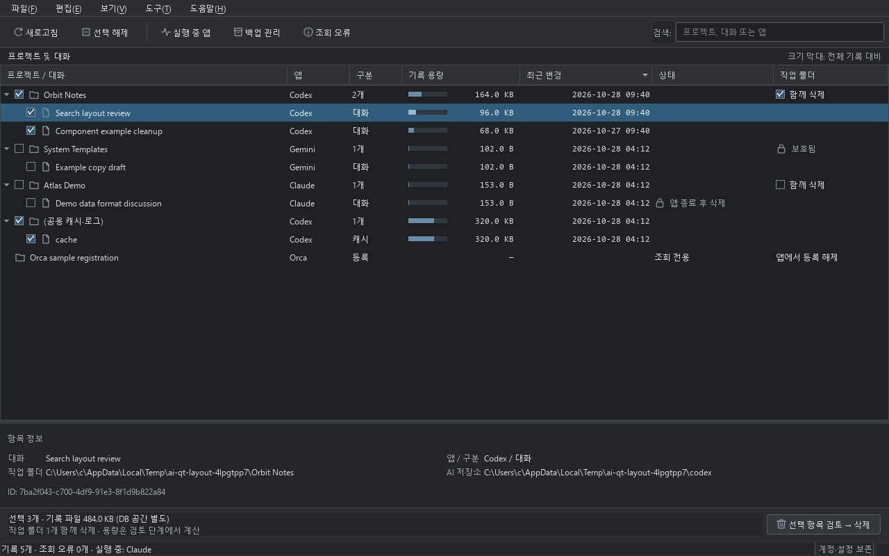

# Agents Cleaner

Codex, Claude Code, Gemini CLI, Orca가 PC에 쌓아 둔 대화기록과 캐시를 프로젝트별 목록으로 보여 주고, 체크한 것만 백업한 뒤 정리하는 Windows용 프로그램입니다.



## 실행

Python 3.11 이상이 필요합니다.

```
py -3.11 -m pip install -r requirements.txt
py -3.11 scripts/main.py              # 정리
py -3.11 scripts/main.py --read-only  # 목록만 보기
py -3.11 scripts/main.py --inventory  # 개수만 출력 (제목·내용 없음)
```

탐색기에서 `실행.cmd` 또는 `읽기전용.cmd`를 더블클릭해도 됩니다. PySide6가 없으면 기본 Tkinter 화면으로 실행됩니다.

## 지우는 방식

| 대상 | 방식 |
|---|---|
| Codex 대화 | 대화 원문(`.jsonl`, `.jsonl.zst`)과 DB 스냅샷을 ZIP으로 백업한 뒤 공식 `codex delete` 명령으로 삭제 |
| Claude Code · Gemini 대화 | ZIP 백업 후 Windows 휴지통으로 이동 |
| 캐시·로그 | 정해진 폴더만 휴지통으로 이동 (백업은 선택) |
| 작업 폴더 | '작업 폴더' 열에서 따로 체크한 경우에만, 그 폴더의 대화를 모두 지운 뒤 휴지통으로 이동 |

로그인 정보, 설정, Claude 프로젝트 메모리, Codex 프로젝트 등록, Orca 프로젝트 등록은 지우지 않습니다.

## 안전장치

- 해당 앱(Codex, Claude, Gemini, Orca)이 실행 중이면 그 앱의 기록은 삭제할 수 없습니다. '실행 중 앱'에서 닫을 프로그램을 확인하세요.
- 드라이브 루트, 사용자 폴더, 바탕화면·문서·다운로드 자체, 시스템·설치 폴더, AI 앱 저장소, 링크·junction은 작업 폴더로 지울 수 없습니다.
- 작업 폴더가 git 저장소이면 커밋하지 않은 변경, push하지 않은 커밋, 원격 없음을 경고합니다.
- 삭제 전 확인 창에서 확인 체크를 해야 진행됩니다.

휴지통을 비우고 '백업 관리'에서 오래된 백업을 지워야 디스크 공간이 실제로 늘어납니다.

## 테스트

```
py -3.11 -m unittest discover -s tests
```

`design/` 폴더에는 화면 시안과 디자인 조사 자료가 있습니다. 모든 시안과 캡처는 가짜 예시 데이터입니다.
